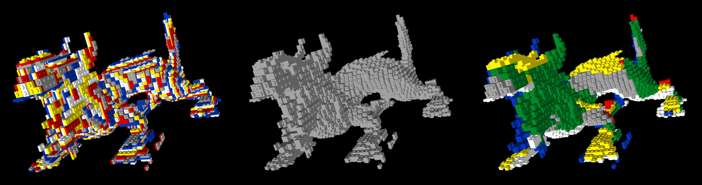
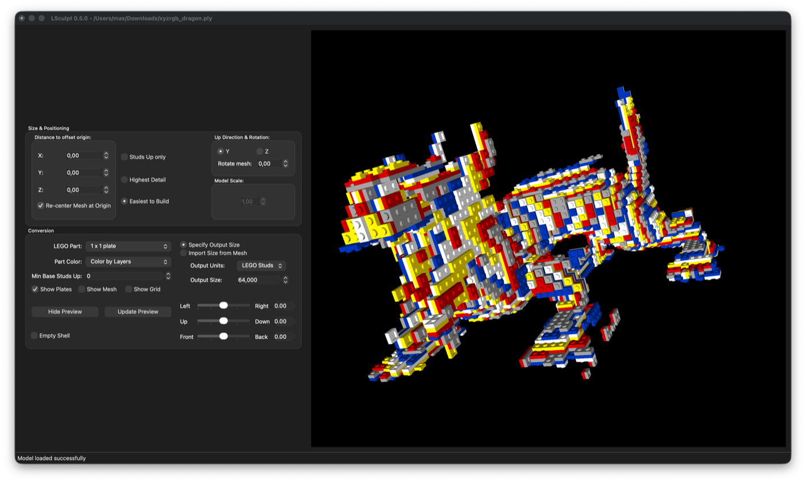
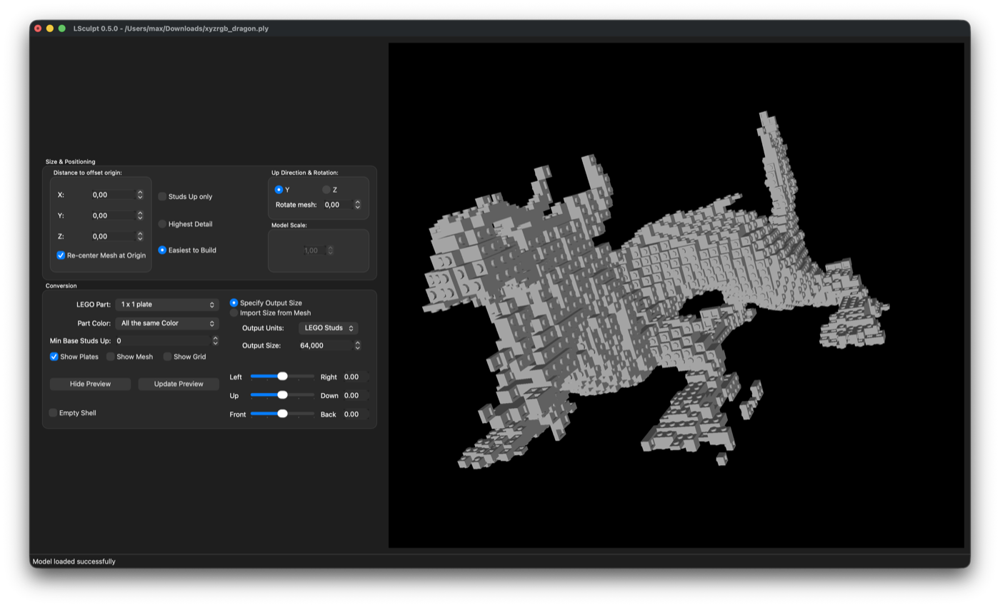
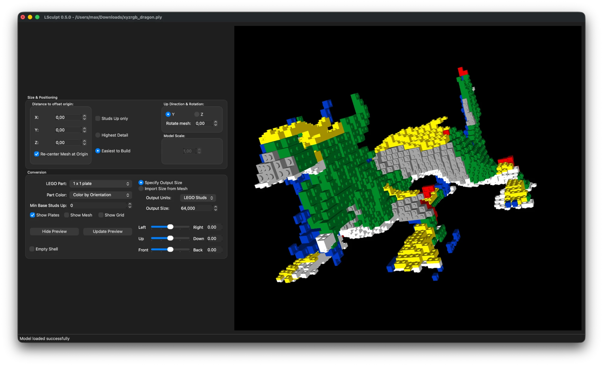

LSculpt: Studs-out LEGO® Sculpture
==================================

LSculpt converts a triangle mesh into an LDraw file. The generated model consists of a surface of 1×1 plates, each oriented in whichever direction provides the best detail for that part of the surface.



*The `xyzrgb_dragon.ply` mesh converted to 1×1 plates (64 studs) with the three Part Color modes: Color by Layers, All the same Color, Color by Orientation.*

Building
--------

LSculpt builds with CMake and Qt6 on Windows, macOS, and Linux. The Qt-native LDraw preview is powered by a vendored copy of Travis Cobbs' [LDView](http://ldview.sourceforge.net/), checked out as a git submodule from [marsiliano/ldview](https://github.com/marsiliano/ldview) (currently pinned to `84d7708`, the latest `origin/master` as of 2026-08-31).

```sh
git clone --recurse-submodules https://github.com/marsiliano/lsculpt.git
cd lsculpt
cmake -B build
cmake --build build
```

If you already cloned without `--recurse-submodules`, run `git submodule update --init` first.

Dependencies (via your system package manager, or vcpkg/Homebrew on Windows/macOS): Qt6 (Core, Widgets, OpenGL, OpenGLWidgets), OpenGL/GLU, zlib, libpng, libjpeg. `tinyxml2` and `gl2ps` are used if found, otherwise the vendored copies in `ldview/3rdParty` are built automatically.

Pass `-DLSCULPT_CONSOLE=ON` to build only the command-line mesh/sculpt core, with no Qt GUI or LDraw preview.

Screenshots
-----------

The Stanford-style `xyzrgb_dragon.ply` mesh converted to 1×1 plates (output size 64 studs), previewed live with the embedded LDView engine. The *Part Color* option changes how the sculpture is colored.

**Color by Layers**



**All the same Color**



**Color by Orientation**



Working with 3D models
-----------------------

**finished models**

The bunny model shown on these pages is from the [Stanford 3D Scanning Repository](http://graphics.stanford.edu/data/3Dscanrep/). A great list of models and model repositories is [available here](http://lodbook.com/models/). Happy hunting!

**converting between 3D formats**

LSculpt currently supports most [PLY](http://en.wikipedia.org/wiki/PLY_%28file_format%29), [STL](http://en.wikipedia.org/wiki/STL_%28file_format%29), and [OBJ](http://en.wikipedia.org/wiki/Obj) files. If you come across other formats, you will need to convert them:
* [MeshLab](http://meshlab.sourceforge.net/), a free program for processing, editing, and converting 3D meshes
* [3D Object Converter](http://web.axelero.hu/karpowh/), a graphical conversion utility between many 3D formats
* [IVCON](http://lego.bldesign.org/LSculpt/ivcon.zip) (149 KB), a Windows command line utility that converts between many 3D formats ([source](http://people.scs.fsu.edu/~burkardt/cpp_src/ivcon/ivcon.html))

**creating your own models**

Many programs can create files that will work with LSculpt.
* Most [3D computer aided design (CAD) software](http://en.wikipedia.org/wiki/Comparison_of_3D_computer_graphics_software) can export to STL.
* [DAZ 3D](http://www.daz3d.com/) and [Poser](http://poser.smithmicro.com/poser.html) can export Wavefront OBJ files.

[LEGO®](http://lego.com/) is a registered trademark of the LEGO Group, which does not sponsor, endorse, or authorize this software project.
